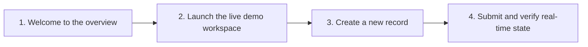
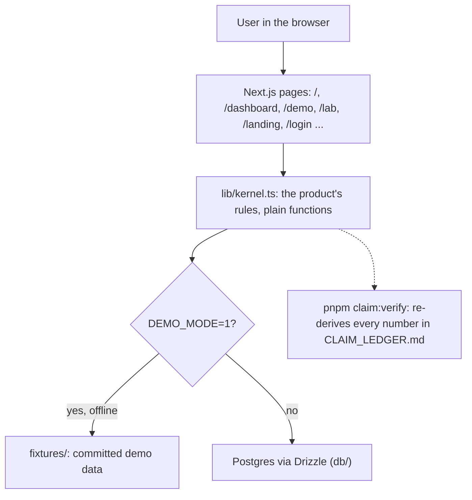

# aib-ship

PayPulse Africa: Automated SME Invoicing and SMS/WhatsApp Payment Reminders

> **Engineered by Ayodeji Adesegun** ([@ayodejiades](https://github.com/ayodejiades))

[](https://github.com/ayodejiades)


## Try it

- **The app:** `/dashboard`, no signup. `DEMO_MODE=1` runs it offline on committed fixtures.
- **How it was checked:** `/proof` and [`CLAIM_LEDGER.md`](CLAIM_LEDGER.md). `pnpm claim:verify` re-derives every number from the committed runs.
- **The demo, step by step:** [`docs/DEMO_PATH.md`](docs/DEMO_PATH.md).

## What it does

PayPulse Africa: Automated SME Invoicing and SMS/WhatsApp Payment Reminders

## How it works

The demo path, step by step:



Architecture:



Next.js and TypeScript, with Drizzle for data. The product's rules live in `lib/kernel.ts` as plain functions, so the same input always gives the same result and the tests call them directly. Recorded runs live in `evidence/campaign-report.json`.

## Bounties targeted

- Main track. Sponsor bounties are chosen in `docs/BOUNTIES.md`.

## Run it

```bash
pnpm install
pnpm claim:verify   # re-derives all claims in CLAIM_LEDGER.md and WHAT_IS_REAL.md
make test           # runs the test suite
make dev            # starts the app locally
make deploy         # deploys to Cloudflare Pages / Vercel
```

## What is real

What is built, partial or not wired yet, measured rather than claimed: [`WHAT_IS_REAL.md`](WHAT_IS_REAL.md).

## Credits

Assets and open-source attributions are listed in [`CREDITS.md`](CREDITS.md).
